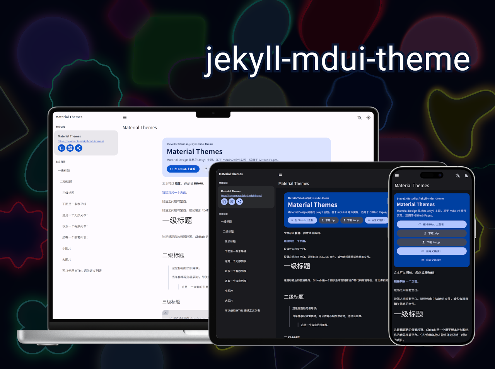

# Jekyll mdui Theme

[](https://github.com/SteveZMTstudios/jekyll-mdui-theme/actions/workflows/pages/pages-build-deployment)
[](https://github.com/SteveZMTstudios/jekyll-mdui-theme/releases)
[](/LICENSE)

简体中文 | [English (US)](README_en.md)

一个面向 GitHub Pages 的 Jekyll 主题，基于 mdui v2 组件实现，支持 `remote_theme` 一键接入。

*mdui 是一个现代 Material Design 组件库。本主题基于 mdui v2 Web Components 实现，你可以[在此预览效果](https://stevezmt.top/jekyll-mdui-theme/)，或者[立刻开始使用](#快速开始github-pages)。*




## 快速开始（GitHub Pages）

在你的站点仓库 `_config.yml` 中加入：

```yml
remote_theme: SteveZMTstudios/jekyll-mdui-theme
plugins:
  - jekyll-remote-theme

title: Your Site Title
description: Your site description

show_downloads: true
theme_color: "#0b57d0"
url: "https://<username>.github.io"
baseurl: "" # 用户主页仓库留空；项目仓库填 "/<repo>"
```

如果你希望固定版本，可使用：

```yml
remote_theme: SteveZMTstudios/jekyll-mdui-theme@v1.0.0
```

### 关于 assets（避免 404）

本主题的 CSS/JS 位于主题仓库的 `assets/` 目录中。
在 `remote_theme` + `jekyll-remote-theme` 模式下，这些资源会在构建阶段被 Jekyll 使用并输出，用户仓库无需复制一份 `assets`。

如果你看到 404，优先检查：

1. `_config.yml` 里是否已启用：
  - `remote_theme: SteveZMTstudios/jekyll-mdui-theme`
  - `plugins: [jekyll-remote-theme]`
2. `baseurl` 是否与部署路径一致（项目站点通常是 `/<repo>`）。
3. 是否被本地同路径文件覆盖（例如你自己的 `assets/css/style.css`）。


或者，基于此框架进行修改：

<a href="https://github.com/new?template_name=jekyll-mdui-theme&template_owner=SteveZMTstudios">
  
</a>

> [!WARNING]
> 若直接使用模板创建仓库，请先按需删除示例内容（如 `test.md`、`THEME_SYNTAX.md`等）。

## 本地预览（使用 remote_theme 的站点）

在你的站点仓库 `Gemfile` 中确保有：

```ruby
source "https://rubygems.org"

gem "github-pages", group: :jekyll_plugins
gem "jekyll-remote-theme", group: :jekyll_plugins
gem "webrick", "~> 1.9"
```

> [!NOTE]
> `github-pages` 能让本地预览与 GitHub 托管构建保持一致，但它同时把这些传递依赖钉死在历史版本上，其中 `rubyzip` 2.x 存在路径穿越漏洞（CVE-2026-85396）。
> 如果你的站点不使用 `github-pages`（例如自建 CI 或部署到其他平台），请改用带安全修复的版本：
>
> ```ruby
> gem "jekyll-remote-theme", "~> 0.6.3"
> gem "rubyzip", ">= 3.4.0"
> ```

然后执行：

```bash
bundle install
bundle exec jekyll serve
```

访问：<http://127.0.0.1:4000>

## 主题特性

- mdui v2 原生组件布局（Top App Bar、Navigation Drawer、List、Button、Fab）
- Material Design 3 风格
- 自动生成文章目录（H1/H2/H3）
- 代码块复制按钮
- 针对打印机优化的样式
- 加密文档以仅供授权用户访问
- 动态配色（基于 `theme_color` 生成 Material 配色）
- 内置翻译脚本（单语言编写，全球用户自动翻译）
- 亮色 / 暗色 / 自动主题切换
- 响应式设计（手机、平板、桌面）
- 侧边栏文章卡片（标题 + URL 复制、Web Share、二维码）
- GitHub Pages 风格按钮（View on GitHub / Download .zip / Download .tar.gz）

## 加密文档

主题内置前端解密逻辑，配套脚本可在构建前对 Markdown 进行加密或解密。

### 1) 在 Markdown 中声明加密

在 Front Matter 中添加 `password` 字段：

```yml
---
title: 需要加密的页面
password: "your-password"
password_prompt: "输入密码以解密此页" # 可选：自定义弹窗提示
---
```

> [!WARNING]
> 1. 加密仅保护 Markdown 正文，页面标题、URL、图片等资源仍然可见。
>    若需要保护图片，请考虑通过 DataURL 引入。另见 [MDN DataURL](https://developer.mozilla.org/zh-CN/docs/Web/URI/Reference/Schemes/data)。
> 2. 建议的密码长度至少为 20 个字符，并包含大小写字母、数字和特殊字符。
> 3. 加密后请妥善保管密码，丢失后无法恢复原始内容。

### 2) 执行加密脚本


```bash
pip install cryptography
cd path/to/your/site
curl -s https://stevezmt.top/jekyll-mdui-theme/script/encrypt.py | python -
```
或者直接从 GitHub：
```
curl -s https://raw.githubusercontent.com/SteveZMTstudios/jekyll-mdui-theme/main/script/encrypt.py | python3 -
```


### 3) 还原为未加密状态

使用解密脚本还原原始 Markdown 正文，需要输入密码：

```bash
curl -s https://stevezmt.top/jekyll-mdui-theme/script/decrypt.py | python -
```

```bash
curl -s https://raw.githubusercontent.com/SteveZMTstudios/jekyll-mdui-theme/main/script/decrypt.py | python3 -
```


## 配置项

mdui 主题会遵循以下变量配置（在 `_config.yml` 中设置）：

```yml
title: [你的网站标题]
description: [你的网站简介]
```

另外，你也可以选择设置以下可选变量：

```yml
repository: [GitHub 仓库路径，格式如 octocat/hello-world]
show_downloads: true  # 是否显示下载按钮，true 或 false（不加引号）
theme_color: "#0b57d0"  # 主题配色种子色（Material Design 配色源）
google_analytics: [你的 Google Analytics 追踪 ID]  # 可选

# 可选：在 hero-actions 下追加自定义按钮
links:
  - name: "文档"
    url: "https://example.com/docs"
    icon: "description"   # 可选，Material Icons 名称
    variant: "tonal"      # 可选：elevated/filled/tonal/outlined/text（flat 会自动转为 text）
    _target: "_blank"     # 可选，默认 _self
    rel: "noopener noreferrer" # 可选，_blank 且未填写时会自动补齐
```

完整的配置项请参见 [Wiki（简体中文）](https://github.com/SteveZMTstudios/jekyll-mdui-theme/wiki) [THEME_SYNTAX.md](THEME_SYNTAX.md) 和 [_config.yml](_config.yml)。

### 覆盖 GitHub 自动生成的 URLs

模板通常依赖 GitHub 提供的 URL（如指向你的仓库的链接或下载项目的链接）。如果你想覆盖其中一个或多个 URL：

1. 查看[布局源代码](https://github.com/SteveZMTstudios/jekyll-mdui-theme/blob/main/_layouts/default.html)以确定变量名称。它通常采用 `{{ site.github.zip_url }}` 的形式。
2. 在你的网站 `_config.yml` 中指定你想使用的 URL。例如，如果变量是 `site.github.zip_url`，你应该添加：
    ```yml
    github:
      zip_url: https://example.com/download.zip
      repository_url: https://example.com/your-repo
      tar_url: https://example.com/download.tar.gz
    ```
3. 当你的网站被构建时，Jekyll 会使用你指定的 URL，而不是 GitHub 提供的默认 URL。

*注意：你必须移除 `site.` 前缀，每个变量名（在 `github:` 之后）应该用两个空格缩进。*

### 自定义 CSS 样式

如果你想添加自己的自定义样式：

1. 在你的网站中创建一个文件：`/assets/css/style.scss`
2. 在该文件的最上面添加以下内容，**完全按照所示的方式**：
    ```scss
    ---
    ---

    @import "{{ site.theme }}";
    ```
3. 在 `@import` 行之后立即添加任何你想要的自定义 CSS（或 Sass，包括 imports）

*注意：如果你想更改主题的 Sass 变量，你必须在 stylesheet 中的 `@import` 行**之前**设置新值。*

### 覆盖布局

如果你想更改主题的 HTML 布局：

#### 小改动

1. 你可以在本地 `_includes` 文件夹中添加自定义文件。
2. 本主题提供的[默认 includes](https://github.com/SteveZMTstudios/jekyll-mdui-theme/tree/main/_includes) 是一个很好的起点，并由[原始布局模板](https://github.com/SteveZMTstudios/jekyll-mdui-theme/blob/main/_layouts/default.html)包含。

例如，要添加自定义 Google Analytics：

1. 在 `_includes/head-custom-google-analytics.html` 中粘贴你从 Google 获得的最新 Analytics 代码。
2. 本主题会自动包含该文件。

#### 重大改动

0. 阅读 [Wiki（简体中文）](https://github.com/SteveZMTstudios/jekyll-mdui-theme/wiki) ，确认你需要覆盖的部分无法通过参数或 includes 实现。
1. [复制原始模板](https://github.com/SteveZMTstudios/jekyll-mdui-theme/blob/main/_layouts/default.html)
   （*Protip：点击 "raw" 可以更容易地复制*）
2. 在你的网站中创建一个文件：`/_layouts/default.html`
3. 将第一步复制的布局内容粘贴进去
4. 根据你的需求自定义该布局


## 主题结构与兼容性

本仓库已按 GitHub Pages 主题常见结构整理，既可以作为 `remote_theme` 远程主题使用，也具备标准 Jekyll 主题 gem 的目录形态：

- `_layouts/default.html` - 主布局模板
- `_includes/head-custom.html` - 可在站点中覆盖的自定义头部入口
- `assets/css/*` 与 `assets/js/*` - 样式和脚本文件
- `lib/jekyll-mdui-theme.rb` - 主题 Ruby 入口
- `lib/jekyll-mdui-theme/version.rb` - 版本定义
- `jekyll-mdui-theme.gemspec` - Gem 规范文件

### 浏览器兼容策略

- **现代浏览器**：完整的 mdui Web Components 体验与 Material Design 3 动态交互。
- **旧式与兼容浏览器（Safari >= 5, iOS >= 5, Android >= 4.0, IE >= 9）**：自动转换/平滑降级至兼容阅读模式，保障排版布局、响应式导航、图片/媒体渲染、深浅色主题切换及代码复制等核心体验不受影响。
- **禁用 JavaScript 场景**：保障页面内容基本排版可读、媒体可渲染、超链接可访问。


## 本地开发

如果你想在本地预览主题（例如在提出变更时）：

1. 克隆本主题仓库：`git clone https://github.com/SteveZMTstudios/jekyll-mdui-theme`
2. 进入仓库目录：`cd jekyll-mdui-theme`
3. 运行 `bundle install` 安装必要的依赖
4. 运行 `bundle exec jekyll serve` 启动预览服务器
5. 在浏览器中访问 [`localhost:4000`](http://localhost:4000) 预览主题

### 依赖版本与安全

- 主题仓库自身使用 **Jekyll 4.4** 构建（见 `Gemfile`），不再引入 `github-pages`：后者会把 `jekyll`、`liquid`、`rouge`、`rubyzip`、`jekyll-sass-converter`（Ruby Sass 3.x）等一整套传递依赖固定在已停止安全更新的版本上。
- 本仓库是**主题仓库**而非"使用主题的站点仓库"，`_config.yml` 使用 `theme: null` 且没有 `remote_theme`，因此本地构建**不需要** `jekyll-remote-theme` 插件——它只对引用远程主题的消费者站点有意义。
- 主题以 `remote_theme` 分发时，托管构建使用 GitHub 侧的插件版本，因此本仓库升级 Jekyll 不会影响使用者的托管构建结果。
- `Gemfile` 中显式声明了传递依赖的安全下限（`addressable`、`concurrent-ruby`、`json`、`faraday`），取值对应各自 CVE / GHSA 的修复版本，修改依赖时请勿回退。
- 定期复核依赖漏洞（应输出 `No vulnerabilities found`）：

```bash
bundle exec bundle-audit check --update
```

- `gemfiles/` 下提供两个独立对照环境，按需使用：

| 文件 | 用途 | 说明 |
| --- | --- | --- |
| `gemfiles/github_pages.gemfile` | 复刻 GitHub Pages 托管构建 | 会带入已停止安全更新的旧依赖，仅用于"构建是否等价"的对照 |
| `gemfiles/remote_theme.gemfile` | 验证 `remote_theme` 消费路径 | Windows 上需先安装 OpenSSL 开发库，见文件内注释 |

```bash
BUNDLE_GEMFILE=gemfiles/github_pages.gemfile bundle install
BUNDLE_GEMFILE=gemfiles/github_pages.gemfile bundle exec jekyll build
```

### 前端资源构建 (CSS / JS)

源码逻辑分别维护于 `assets/css/*.src.css` 与 `assets/js/*.src.js` 中。利用 PostCSS (`postcss-preset-env`)、Babel (`@babel/preset-env` + `babel-plugin-polyfill-corejs3`) 与 esbuild 自动构建出兼容 `safari >= 5, iOS >= 5, Android >= 4.0, ie >= 9` 的目标产物：

```bash
# 安装前端构建依赖
npm install

# 编译所有前端 CSS 和 JS 产物
npm run build

# 单独编译 CSS 或 JS
npm run build:css
npm run build:js
```

### 运行测试

本主题包含最小限度的测试套件，以确保使用该主题的网站能够成功构建：

```bash
bundle exec jekyll build
```

## 贡献

对于改进 mdui 主题感兴趣？我们很乐意接受你的帮助。mdui 主题是一个开源项目，由像你这样的用户一次贡献一个功能而构建的。

如果你发现 bug 或有功能建议：

- 请在 [GitHub Issues](https://github.com/SteveZMTstudios/jekyll-mdui-theme/issues) 上提出
- 欢迎提交 Pull Request

## 许可证

[MIT License](LICENSE)

